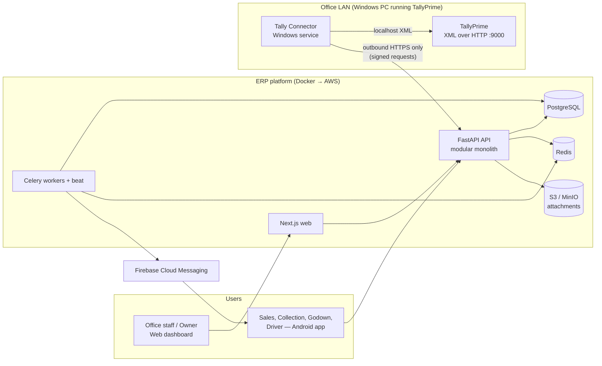
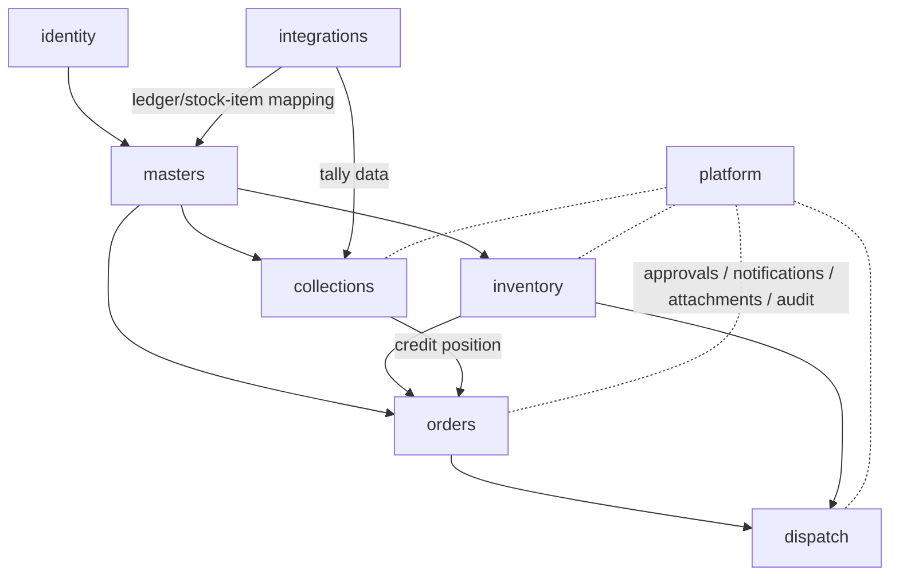

# A. Phase 1 System Architecture

## 1. Context



Tally is **never** reachable from the internet. The connector sits next to Tally, talks to it on `localhost:9000`, and makes **outbound** HTTPS calls to the ERP. The ERP never opens a connection into the office.

## 2. Components

| Component | Technology | Responsibility |
|-----------|-----------|----------------|
| API | Python 3.12, FastAPI, SQLAlchemy 2.0 (sync sessions), Pydantic v2, Alembic | All business rules, state machines, authorization, persistence |
| Workers | Celery 5 + Redis broker, Celery beat | Tally import processing, outstanding recalculation, promise monitoring, notifications, Excel imports/exports, report generation |
| Database | PostgreSQL 16 | Single database, single schema, all modules |
| Cache / locks | Redis 7 | Celery broker, rate-limit counters, short-lived dashboard caches, distributed task locks |
| File storage | S3 API (MinIO locally, S3 in AWS) | Attachments, POD photos/signatures, import files, generated reports. Private bucket, presigned URLs only |
| Web | Next.js 15 (App Router), TypeScript, TanStack Query, TanStack Table, shadcn/ui + Tailwind, react-hook-form + zod | Office dashboard. Talks only to the API through a client **generated from the OpenAPI spec** |
| Android | Flutter 3, Riverpod, dio, go_router, drift (SQLite, encrypted with SQLCipher), flutter_secure_storage, firebase_messaging | Role-specific field app with offline drafts and a sync queue |
| Tally connector | Python 3.12, packaged as a Windows service (PyInstaller + NSSM/pywin32), local SQLite queue | Pulls masters/vouchers/bills from TallyPrime, uploads signed batches |
| Reverse proxy | Caddy (local/single-host) → AWS ALB later | TLS, routing `/api` vs web |

## 3. Key decisions and trade-offs

| Decision | Chosen | Alternative | Why |
|----------|--------|-------------|-----|
| Service shape | **Modular monolith** — one FastAPI app, one module per domain with its own models/services/routers | Microservices | 20 users, ~₹50 cr turnover. Order approval must reserve stock and check credit in one DB transaction; microservices would turn that into a distributed saga. Module boundaries are kept strict so a module can be split out later. |
| Sync vs async SQLAlchemy | **Sync** sessions in a threadpool | async | Simpler transactions and `SELECT … FOR UPDATE` semantics, same code in Celery tasks; load is low. |
| Inventory | **Append-only movement ledger + locked balance projection** | Mutable stock fields | Required by the brief; balance rows give O(1) availability checks and a row to lock against double allocation. |
| Order fulfilment status | **Derived from line quantities** (allocated/dispatched/delivered) | Manually set | Prevents status and quantities disagreeing. Human decisions (submit, approve, hold, cancel, close) are commands. |
| Company isolation | **Application-enforced**: every repository query goes through a scoped query helper that requires the caller's company/godown scope; tested by an isolation test suite | PostgreSQL row-level security | RLS is stronger but complicates background jobs and cross-company owner reports. Revisit RLS before giving any external party access. |
| Tally access | **Pull by an on-prem connector, push to ERP** | ERP calls Tally over Tailscale/VPN | Works unchanged when the ERP moves to AWS, needs no inbound port, survives Tally being closed (connector queues and retries). The existing Tailscale setup remains a fallback for support. |
| Events | **Transactional outbox** table written in the same transaction as the business change; a worker publishes | Fire Celery tasks inside request | A rolled-back transaction can never send a notification; retries are deduplicated by event id. |
| Web data fetching | Client components + TanStack Query against the API | Next.js server actions with business logic | Keeps exactly one place (FastAPI) for rules; web and Android share it. |
| Mobile offline | **Drafts + queued commands with client UUIDs**; server validates on sync | Full offline database replication | Offline actions must not bypass stock/credit/payment checks; queued commands are simply re-validated server-side. |

## 4. Backend module layout

```
backend/app/
  core/            config, db session, security (JWT, hashing), permissions, errors, pagination,
                   idempotency, audit, outbox, sequences, money/qty types, time (UTC ↔ IST)
  modules/
    identity/      users, roles, permissions, scopes, auth, refresh tokens
    masters/       companies, dealers (+contacts, addresses, rates), brands, products,
                   UoM & conversions, godowns, transporters, vehicles, drivers, employees
    orders/        sales orders, items, revisions, approvals, credit checks
    inventory/     owners, balances, movements, receipts, reservations, transfers,
                   adjustments, batches, stock counts, imports
    dispatch/      delivery orders, trips, loading, gate passes, delivery events, POD,
                   exceptions, freight
    collections/   receivables, outstanding, aging, assignments, follow-ups, promises,
                   payment reports, reconciliation, targets, priority scores
    integrations/  tally (connector API, staging, importers, reconciliation), sync jobs
    platform/      approvals engine, notifications, attachments, settings, reports, audit log API
  workers/         celery app, beat schedule, task modules (one per domain)
```

Each module exposes: `models.py`, `schemas.py` (Pydantic), `service.py` (business commands — the only place that writes), `queries.py` (read models/dashboards), `router.py`, `state_machine.py` where relevant, `permissions.py`. **Modules call each other only through service functions**, never by writing each other's tables. Example: `orders.service.approve()` calls `inventory.service.reserve()` and `collections.service.credit_position()` inside the same DB transaction.

### Cross-module dependency map



Arrows mean "depends on". No cycles: inventory does not know about orders (reservations reference a generic `source_type/source_id`), dispatch calls inventory to post movements, collections never calls orders.

## 5. Cross-cutting mechanics

**Transactions & concurrency**
- One DB transaction per command. Stock and money commands lock affected `inventory_balances` / document rows with `SELECT … FOR UPDATE`, always in a deterministic order (sorted by balance id) to avoid deadlocks.
- Documents that humans edit (orders, DOs, transfers, dealers) carry a `version` integer; updates must send the version they read (optimistic locking → HTTP 409 on conflict).
- Database `CHECK` constraints back up the rules (e.g. available quantity ≥ 0 unless the row is flagged for an authorised negative).

**Idempotency** — Critical POSTs accept an `Idempotency-Key` header. The key, request hash and stored response live in `idempotency_keys` (unique per user+key, 48h TTL). A retry returns the original response; same key with a different body → 422.

**Document numbering** — `document_sequences(company_id, doc_type, fiscal_year)` row locked on use. Format configurable per company, default `{PREFIX}/{DOC}/{FY}/{SEQ:06}` e.g. `ATT/SO/2627/000123`. Indian fiscal year April–March.

**Audit** — Every command writes `audit_logs` (who, when, action, entity, before/after JSON diff, IP, device, request id). Status changes additionally go to per-entity history tables. Audit rows are insert-only (DB role has no UPDATE/DELETE on that table).

**Outbox & notifications** — `outbox_events` written in-transaction; a beat-driven publisher dispatches to handlers. Each notification has a unique `dedupe_key` (e.g. `promise_due:{promise_id}:{date}`), so a retried task cannot send twice.

**Time** — All timestamps `timestamptz` in UTC; business dates (`order_date`, `due_date`, `promise_date`) are `date` in IST. Day boundaries for "today" dashboards use Asia/Kolkata.

**Numbers** — `NUMERIC` everywhere: money `NUMERIC(18,2)`, rates `NUMERIC(18,4)`, quantities `NUMERIC(18,3)` for entered values and `NUMERIC(20,6)` for normalized base quantities. Python uses `Decimal`; JSON transports them as strings.

**Errors** — RFC 7807 `application/problem+json` with a stable `code` (e.g. `ORDER_INVALID_TRANSITION`, `STOCK_INSUFFICIENT`, `CREDIT_HOLD`) that both clients map to messages.

**Observability** — Structured JSON logs (structlog) with request id / user id / company id; `/health/live`, `/health/ready` (DB, Redis, S3); Celery task events and a "Sync & Jobs" admin page; Sentry-compatible error reporting optional.

## 6. Environments & deployment

| Stage | Setup |
|-------|-------|
| Local dev | `docker compose up`: postgres, redis, minio, api, worker, beat, web, caddy, mailpit. Flutter runs against the local API. Seed script loads clearly-labelled demo data into a **demo company** only. |
| Office pilot (optional) | Same compose on a single machine/VM with daily `pg_dump` to S3 and WAL archiving. |
| AWS | ECS Fargate (api, worker, beat, web) behind ALB; RDS PostgreSQL (Multi-AZ, PITR 14 days); ElastiCache Redis; S3 with versioning + SSE; Secrets Manager; CloudWatch logs; region ap-south-1 (Mumbai) for data residency and latency. |

Details in [08-development-plan.md](08-development-plan.md) Step 8.

## 7. Designed-for-later (not built in Phase 1)

| Future module | Hook already in Phase 1 |
|---------------|------------------------|
| WhatsApp order intake | `sales_orders.source`, `source_ref`, `source_payload` JSONB; `inbound_messages` table reserved |
| GPS tracking | `delivery_events` has `lat/lng/accuracy/source`; `vehicles.gps_device_id` |
| Push sales invoices to Tally | `tally_outbound_vouchers` table + connector "write" job type reserved; orders keep `invoice_ref` |
| Purchase accounting / GL | Inventory receipts already carry supplier, invoice ref, cost fields |
| Payroll, CRM, forecasting | Separate modules on top of `employees`, `dealers`, sales history |
