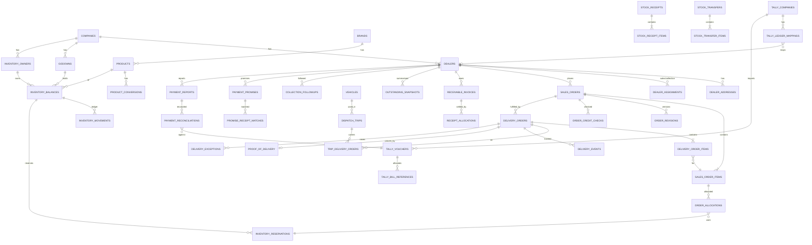

# B. Database Schema & Entity Relationships

PostgreSQL 16, SQLAlchemy 2.0 models, Alembic migrations. Conventions:

- `id UUID PK` (UUIDv7 generated in app → index-friendly ordering). Human numbers (`order_no`) are separate unique columns.
- Every business table: `company_id UUID NOT NULL FK`, `created_at`, `created_by`, `updated_at`, `updated_by`. Editable documents add `version INT NOT NULL DEFAULT 1`.
- Soft deactivation (`is_active`) for masters; **no hard deletes** of transactional rows.
- Types: money `NUMERIC(18,2)`, rate `NUMERIC(18,4)`, entered qty `NUMERIC(18,3)`, base qty `NUMERIC(20,6)`. No floats anywhere.
- Enums stored as `TEXT` + `CHECK` (easier migrations than PG enums).
- Below, `→ table` means a foreign key. Indexes listed only where non-obvious (all FKs are indexed).

---

## 1. Quantity & unit model (the part that must be right)

Each product has a **base unit** in which all stock and reservations are held:

| Category | Base unit | Why |
|----------|-----------|-----|
| Cement | `BAG` | Physically counted, loaded and damaged in bags. Bag weight is a product attribute (50 kg normal, 20 kg for JSW Microfine-type packs). |
| TMT | `KG` | Sold, invoiced and weighed by weight; pieces/bundles are secondary counts. |

Conversions are data, not code:

```
uoms(code PK, name, kind[COUNT|WEIGHT|LENGTH])         -- BAG, MT, KG, PC, BDL, QTL
product_conversions(
  id, product_id → products NULL, brand_id → brands NULL, category NULL,   -- most specific wins
  from_uom, to_uom, factor NUMERIC(20,8),               -- 1 from_uom = factor to_uom
  basis [NOMINAL|ACTUAL_AVG], effective_from DATE, effective_to DATE NULL,
  source_note TEXT)                                     -- e.g. "Kamdhenu weight chart 2026"
```
Examples: `Shree PPC 50kg: MT→BAG = 20`; `JSW Microfine 20kg: MT→BAG = 50`; `Kamdhenu Fe550D 12mm: PC→KG = 10.656` (0.888 kg/m × 12 m); `Kamdhenu 12mm: BDL→PC = 10`.

Every quantity line stores **both**:
```
entered_qty NUMERIC(18,3), entered_uom TEXT,          -- what the user typed: 25 MT
base_qty    NUMERIC(20,6),                            -- 500 BAG
conversion_id → product_conversions, conversion_factor NUMERIC(20,8)  -- frozen at entry
```
The factor is copied onto the line, so later changes to a conversion chart never rewrite history. TMT lines also carry `pieces INT NULL`, `bundles INT NULL`, and at loading time `actual_weight_kg` (weighbridge) vs `nominal_weight_kg`, giving the variance report.

---

## 2. Core / masters

```
companies(id, code UNIQUE, legal_name, trade_name, gstin, pan, address JSONB, state_code,
          doc_prefix, fiscal_year_start_month DEFAULT 4, is_active)

users(id, phone UNIQUE, email UNIQUE NULL, full_name, password_hash, is_active,
      mfa_enabled, last_login_at, employee_id → employees NULL, failed_logins, locked_until)
roles(id, code UNIQUE, name, is_system)
permissions(code PK, module, description)                      -- e.g. orders.approve
role_permissions(role_id → roles, permission_code → permissions)  PK(role_id, permission_code)
user_roles(user_id → users, role_id → roles, company_id → companies)  PK(all 3)
   -- roles are granted per company: a user can be Sales Exec in A T Trading and nothing in Tayal Traders
user_godown_scopes(user_id, godown_id)                         -- godown supervisors
refresh_tokens(id, user_id, family_id, token_hash UNIQUE, device_id, issued_at,
               expires_at, rotated_at NULL, revoked_at NULL, revoke_reason)
devices(id, user_id, platform, fcm_token, app_version, last_seen_at)

employees(id, company_id, code, full_name, phone, designation, reports_to → employees, is_active)

-- D5: dealers are created/updated only by the Tally sync (Sundry Debtors ledgers); the ERP
--     edits operational fields only. tally_ledger_guid is the natural key.
dealers(id, company_id, code, name, legal_name, tally_ledger_name, tally_ledger_guid UNIQUE(company),
        aliases TEXT[], gstin NULL, pan NULL, category[DEALER|RETAILER|
        CONTRACTOR|BUILDER|INSTITUTION], status[ACTIVE|BLOCKED|INACTIVE], blocked_reason,
        payment_terms_days, credit_limit NUMERIC(18,2) NULL, allowed_overdue_days INT NULL,
        credit_policy[STRICT|WARN|NONE], default_sales_exec_id → employees,
        tally_ledger_mapping_id → tally_ledger_mappings NULL, version)
  UNIQUE(company_id, code)
dealer_contacts(id, dealer_id, name, phone, role, is_primary, whatsapp_opt_in)
dealer_addresses(id, dealer_id, kind[BILLING|DELIVERY|SITE], label, line1, line2, area, city,
                 state_code, pincode, lat NULL, lng NULL, distance_km_from JSONB NULL, is_active)
dealer_assignments(id, dealer_id, employee_id, kind[SALES|COLLECTION], valid_from, valid_to NULL,
                   assigned_by, reason)   -- history kept; one open row per (dealer, kind)
  EXCLUDE overlapping (dealer_id, kind) periods

brands(id, code UNIQUE, name, category[CEMENT|TMT], manufacturer)
products(id, code UNIQUE, name, brand_id, category[CEMENT|TMT], base_uom,
         -- cement
         cement_grade NULL (OPC43|OPC53|PPC|PSC|PCC…), bag_weight_kg NULL,
         -- TMT
         tmt_grade NULL (Fe500|Fe500D|Fe550|Fe550D…), diameter_mm NULL, length_m NULL,
         hsn_code, gst_rate NUMERIC(5,2), is_batch_tracked, shelf_life_days NULL, is_active)
product_units(product_id, uom, is_sellable, is_default_entry)      -- which units may be entered
product_conversions(…see §1…)
company_products(company_id, product_id, tally_stock_item_name NULL, is_active)
   -- per-company naming (his Tally stock items differ per company)

dealer_rates(id, company_id, dealer_id, product_id, godown_id NULL, uom, rate NUMERIC(18,4),
             tolerance_pct NUMERIC(5,2) DEFAULT 0, source[MANUAL|TALLY_LAST_SALE],
             valid_from DATE, valid_to DATE NULL, approved_by NULL, version)
   -- D5: rates are customer-specific. Resolution: dealer+godown → dealer → last Tally sale rate
   --     (tally_sale_lines) for that dealer+item. Rate below (rate − tolerance) needs approval.
tally_sale_lines(id, tally_voucher_id, stock_item_name, product_id NULL, godown_name, qty, uom,
                 rate NUMERIC(18,4), amount)       -- inventory entries of synced Sales vouchers

godowns(id, company_id, code, name, address JSONB, city, contact_person, phone,
        supervisor_employee_id, status[ACTIVE|INACTIVE|BLOCKED], kind[GODOWN|DIRECT|SIDING|VIRTUAL],
        supported_categories TEXT[], capacity_base_qty NULL, capacity_uom NULL,
        tally_godown_name NULL)
   -- kind=DIRECT models "Direct" (factory-to-site) dispatch where no physical godown holds stock

transporters(id, company_id, name, gstin NULL, phone, is_own_fleet, is_active)
vehicles(id, company_id, registration_no UNIQUE, vehicle_type[TRUCK_6W|TRUCK_10W|TRUCK_12W|
         TRAILER|TRACTOR|PICKUP|OTHER], capacity_kg, capacity_bags NULL, transporter_id,
         ownership[OWN|ATTACHED|MARKET], status[AVAILABLE|ON_TRIP|MAINTENANCE|INACTIVE],
         gps_device_id NULL)
drivers(id, company_id, name, phone, licence_no NULL, user_id → users NULL, transporter_id NULL, is_active)
```

---

## 3. Inventory

### Ownership

```
inventory_owners(id, company_id, kind[OWN_TRADING|PRINCIPAL_CF|CONSIGNMENT], name,
                 principal_name NULL, external_ref NULL, is_active)
   -- e.g. "A T Trading – own stock", "JSW Cement – C&F stock (principal-owned)"
owner_sale_rules(owner_id, selling_company_id, allowed BOOL, requires_approval BOOL)
   -- the ONLY way C&F stock can be allocated to an own-trading order
```

### Stock buckets, balances, movements

A **stock bucket** is the unique combination
`(company_id, owner_id, godown_id, product_id, batch_id NULL, status)`, where status ∈
`GOOD | DAMAGED | QUARANTINE | IN_TRANSIT`. In-transit stock lives in a bucket whose
`godown_id` is a per-transfer **virtual in-transit location**, so neither source nor destination counts it.

```
inventory_balances(
  id, company_id, owner_id, godown_id, product_id, batch_id NULL, status,
  qty_on_hand NUMERIC(20,6) NOT NULL DEFAULT 0,      -- physical in this bucket
  qty_reserved NUMERIC(20,6) NOT NULL DEFAULT 0,     -- only meaningful when status=GOOD
  allow_negative BOOL DEFAULT false,                 -- set only by an approved process
  last_movement_id, version,
  UNIQUE NULLS NOT DISTINCT (company_id, owner_id, godown_id, product_id, batch_id, status),
  CHECK (allow_negative OR (qty_on_hand >= 0 AND qty_on_hand - qty_reserved >= 0))
)
-- available = qty_on_hand - qty_reserved (GOOD buckets only)

inventory_movements(              -- APPEND ONLY (no UPDATE/DELETE grants)
  id, company_id, movement_no, movement_type, occurred_at, posted_at,
  owner_id, godown_id, product_id, batch_id NULL, status,
  qty_base NUMERIC(20,6) NOT NULL,          -- signed: +in / -out
  entered_qty, entered_uom, conversion_factor,
  pieces NULL, bundles NULL, weight_kg NULL,
  balance_id → inventory_balances, balance_after NUMERIC(20,6),
  source_type, source_id, source_line_id,   -- e.g. STOCK_RECEIPT / DELIVERY_ORDER / ADJUSTMENT
  reversal_of_id → inventory_movements NULL,
  reason_code NULL, remarks, posted_by
)
INDEX (product_id, godown_id, occurred_at), (source_type, source_id)
```

Movement types: `RECEIPT, RECEIPT_REVERSAL, DISPATCH_ISSUE, DELIVERY_RETURN, TRANSFER_OUT,
TRANSFER_IN_TRANSIT, TRANSFER_RECEIVE, TRANSFER_SHORTAGE, STATUS_CHANGE (good→damaged etc.),
ADJUSTMENT_GAIN, ADJUSTMENT_LOSS, RECLASSIFICATION_OUT/IN, OPENING_BALANCE`.

**Invariant (tested):** for every balance row, `qty_on_hand = SUM(movements.qty_base)`; a nightly job recomputes and raises a discrepancy if not.

Every movement is posted by `inventory.service.post_movements([...])`, which: locks the balance rows (sorted), applies deltas, checks constraints, inserts movements, writes outbox events — all in the caller's transaction.

### Reservations

```
inventory_reservations(
  id, company_id, balance_id → inventory_balances,   -- GOOD bucket
  source_type[SALES_ORDER|STOCK_TRANSFER], source_id, source_line_id,
  qty_reserved NUMERIC(20,6), qty_consumed NUMERIC(20,6) DEFAULT 0,
  qty_released NUMERIC(20,6) DEFAULT 0,
  status[ACTIVE|PARTIALLY_CONSUMED|CONSUMED|RELEASED],
  created_by, reason, version,
  CHECK (qty_consumed + qty_released <= qty_reserved)
)
```
`inventory_balances.qty_reserved` = sum of open reservation quantities for that bucket, maintained in the same transaction (and verified nightly).

### Receipts, batches, transfers, adjustments, counts, imports

```
stock_batches(id, company_id, product_id, batch_no, receipt_date, manufacture_date NULL,
              heat_no NULL, supplier_ref NULL, notes)   -- cement age / TMT heat number
stock_receipts(id, company_id, receipt_no, owner_id, godown_id, receipt_type[MANUAL|PURCHASE_INVOICE|
               SUPPLIER_DISPATCH|SAP|TRANSFER], supplier_name, supplier_invoice_no, supplier_invoice_date,
               sap_ref NULL, vehicle_no, status[DRAFT|PENDING_GRN|RECEIVED|CANCELLED],
               import_job_id NULL, received_at, received_by, version)
  UNIQUE(company_id, supplier_name, supplier_invoice_no) WHERE status <> 'CANCELLED'   -- duplicate invoice guard
stock_receipt_items(id, receipt_id, product_id, batch_id NULL, invoiced_qty/uom/base,
                    received_good_base, received_damaged_base, shortage_base,
                    unit_cost NUMERIC(18,4) NULL, pieces, bundles, actual_weight_kg)

stock_transfers(id, company_id, transfer_no, owner_id, from_godown_id, to_godown_id,
                in_transit_godown_id (virtual), status[REQUESTED|APPROVED|DISPATCHED|IN_TRANSIT|
                RECEIVED|PARTIALLY_RECEIVED|CANCELLED|REJECTED], vehicle_id, driver_id,
                requested_by, approved_by, dispatched_at, received_at, version)
stock_transfer_items(id, transfer_id, product_id, batch_id, requested_base, dispatched_base,
                     received_good_base, received_damaged_base, shortage_base)

stock_adjustments(id, company_id, adjustment_no, owner_id, godown_id, adj_type[PHYSICAL_CORRECTION|
                  DAMAGE|SHORTAGE|EXCESS|RECLASSIFICATION], reason_code, remarks,
                  status[DRAFT|PENDING_APPROVAL|APPROVED|POSTED|REJECTED], approval_request_id, version)
stock_adjustment_items(id, adjustment_id, product_id, batch_id, from_status, to_status,
                       to_product_id NULL, qty_base, entered_qty, entered_uom)
stock_counts(id, company_id, godown_id, count_no, counted_at, status[OPEN|SUBMITTED|RECONCILED])
stock_count_items(id, count_id, product_id, batch_id, system_qty_base, counted_qty_base,
                  variance_base, adjustment_id NULL)

import_jobs(id, company_id, kind[PURCHASE_INVOICE_XLSX|OPENING_STOCK|DEALERS|PRICE_LIST|…],
            file_attachment_id, column_mapping JSONB, status[UPLOADED|PREVIEWED|VALIDATED|
            POSTING|POSTED|FAILED|CANCELLED], row_count, error_count, summary JSONB,
            posted_document_ids UUID[], created_by)
import_job_rows(id, job_id, row_no, raw JSONB, parsed JSONB, errors JSONB, status)
import_mapping_templates(id, company_id, kind, name, mapping JSONB)   -- "Shree invoice export", "Ambuja export"
```

---

## 4. Orders

```
sales_orders(
  id, company_id, order_no UNIQUE(company), order_date, dealer_id, contact_id,
  billing_address_id, delivery_address_id, site_name NULL,
  sales_exec_id → employees, source[OFFICE|SALES_EXEC|PHONE|WHATSAPP|REPEAT],
  source_ref NULL, source_payload JSONB NULL, repeat_of_order_id NULL,
  priority[LOW|NORMAL|HIGH|URGENT], requested_delivery_date, special_instructions,
  tax_treatment[GST_INTRA|GST_INTER|NON_GST|EXEMPT],
  status, hold_reason NULL, allocation_status[NONE|PARTIAL|FULL], backorder_allowed BOOL,
  subtotal, discount_total, tax_total, grand_total  NUMERIC(18,2),
  current_revision INT, approved_revision INT NULL,
  dedupe_hash TEXT, submitted_at, approved_at, closed_at, invoice_refs TEXT[],
  version)
  INDEX (company_id, status, order_date), (dealer_id, order_date)

sales_order_items(
  id, order_id, line_no, product_id, preferred_godown_id NULL, owner_id NULL,
  entered_qty, entered_uom, base_qty, conversion_factor, pieces NULL, bundles NULL,
  rate NUMERIC(18,4), rate_uom, list_rate, min_rate, rate_override BOOL, rate_approval_id NULL,
  discount_pct, discount_amt, taxable_amt, gst_rate, tax_amt, line_total,
  qty_cancelled_base, qty_allocated_base, qty_dispatched_base, qty_delivered_base, qty_returned_base,
  status[OPEN|CANCELLED|FULFILLED],
  CHECK (qty_cancelled_base <= base_qty) …)

order_revisions(id, order_id, revision_no, snapshot JSONB, change_summary JSONB,
                is_material BOOL, reason, created_by, approval_request_id NULL)
  -- full snapshot of header+lines for every revision; approved values are never overwritten in place
order_status_history(id, order_id, from_status, to_status, action, reason, actor_id, at)
order_approvals(id, order_id, revision_no, approval_type[ORDER|CREDIT_OVERRIDE|RATE_OVERRIDE|
                MATERIAL_CHANGE|CANCEL_AFTER_APPROVAL], decision[APPROVED|REJECTED], reason,
                approver_id, decided_at, approval_request_id)
order_credit_checks(id, order_id, revision_no, checked_at, dealer_id,
                    ledger_balance, invoice_outstanding, overdue_amount, oldest_overdue_days,
                    credit_limit, open_order_exposure, this_order_amount, available_credit,
                    data_as_of TIMESTAMPTZ, is_stale BOOL, stale_policy_applied,
                    result[PASS|WARN|HOLD], reasons JSONB)
order_allocations(id, order_item_id, reservation_id → inventory_reservations, godown_id,
                  owner_id, qty_base, status[ACTIVE|RELEASED|CONSUMED], created_by)
```

`dedupe_hash` = hash(dealer, normalized lines, delivery address, date); submission within the configured window (default 30 min) with the same hash → warning requiring explicit confirmation.

---

## 5. Collections & Tally

```
tally_companies(id, company_id → companies, tally_company_name, tally_guid NULL,
                connector_id, books_from DATE, last_full_sync_at, last_incremental_sync_at,
                last_master_alter_id BIGINT, last_voucher_alter_id BIGINT, status)
tally_connectors(id, name, api_key_id UNIQUE, secret_hash, last_seen_at, version, host_info JSONB, is_active)
tally_ledger_mappings(id, tally_company_id, ledger_name, ledger_guid, parent_group,
                      dealer_id NULL, is_receivable BOOL, opening_balance, credit_period_days NULL,
                      tally_credit_limit NULL, alter_id, last_seen_at)
  UNIQUE(tally_company_id, ledger_guid)

tally_vouchers(id, tally_company_id, guid, master_id, alter_id, voucher_type, voucher_type_parent,
               voucher_no, voucher_date, party_ledger_name, party_mapping_id NULL,
               amount NUMERIC(18,2), narration, is_cancelled, is_optional, is_deleted,
               raw_hash, raw_object_key (S3), imported_batch_id, first_seen_at, last_seen_at)
  UNIQUE(tally_company_id, guid)
tally_bill_references(id, tally_voucher_id, ledger_mapping_id, bill_name,
                      bill_type[NEW_REF|AGST_REF|ADVANCE|ON_ACCOUNT], amount NUMERIC(18,2) signed,
                      credit_period_days NULL, due_date NULL)

receivable_invoices(          -- one row per (ledger, bill) — derived, rebuildable
  id, company_id, tally_company_id, dealer_id, ledger_mapping_id, bill_name, bill_date, due_date,
  origin[OPENING|SALES|DEBIT_NOTE|JOURNAL], origin_voucher_id NULL,
  original_amount, adjusted_amount, pending_amount, status[OPEN|PART_PAID|SETTLED],
  tally_reported_pending NULL, mismatch BOOL)
  UNIQUE(tally_company_id, ledger_mapping_id, bill_name)
receipt_allocations(id, receivable_invoice_id NULL, tally_voucher_id, bill_type, amount, alloc_date)
   -- NULL invoice = advance / on-account / unallocated credit
outstanding_snapshots(id, company_id, dealer_id, as_of TIMESTAMPTZ, data_as_of TIMESTAMPTZ,
                      ledger_balance, invoice_outstanding, unallocated_credit, overdue_amount,
                      current_amount, buckets JSONB, oldest_unpaid_bill_date, oldest_overdue_days,
                      credit_limit, available_credit, last_payment_date, last_payment_amount,
                      payment_terms_days, is_latest BOOL)
  UNIQUE(dealer_id) WHERE is_latest

collection_assignments  → uses dealer_assignments(kind=COLLECTION) (history included)
collection_followups(id, company_id, dealer_id, executive_id, followup_at, contact_method[CALL|VISIT|
                     WHATSAPP|SMS|EMAIL], contact_person, outcome[PROMISED|PAID_PENDING_VERIFY|
                     PART_PROMISED|UNAVAILABLE|DISPUTED|DELAYED|NO_ANSWER|ESCALATE], notes,
                     promise_id NULL, next_followup_date, dispute_reason NULL,
                     status[PLANNED|DONE|MISSED|CANCELLED], is_system_generated, generated_key UNIQUE NULL,
                     client_uuid UNIQUE NULL)
payment_promises(id, company_id, dealer_id, employee_id, promised_amount, promise_date,
                 grace_days, invoice_ids UUID[] NULL, amount_received, status[OPEN|PARTIALLY_FULFILLED|
                 FULFILLED|BROKEN|CANCELLED|SUPERSEDED], broken_at NULL, fulfilled_at NULL,
                 superseded_by_id NULL, created_from_followup_id)
promise_receipt_matches(id, promise_id, tally_voucher_id, amount, matched_by[RULE|MANUAL], rule_code)
payment_reports(id, company_id, report_no, dealer_id, reported_by, amount, payment_date,
                mode[CASH|CHEQUE|NEFT|RTGS|IMPS|UPI|DD|OTHER], utr_ref NULL, cheque_no NULL,
                cheque_date NULL, bank_name, notes, status[REPORTED|PENDING_VERIFICATION|VERIFIED|
                REJECTED|RECONCILED], verified_by, verified_at, reject_reason, client_uuid UNIQUE)
  UNIQUE(company_id, mode, utr_ref) WHERE utr_ref IS NOT NULL AND status <> 'REJECTED'
payment_reconciliations(id, payment_report_id, tally_voucher_id, amount, matched_by, match_score,
                        status[MATCHED|UNDONE], undone_reason, undone_by)
collection_targets(id, company_id, employee_id NULL, period_month DATE, target_amount)
collection_priority_scores(id, dealer_id, computed_at, score NUMERIC(6,2), factors JSONB,
                           rule_version, override_score NULL, override_reason, override_by)
```

---

## 6. Dispatch

```
delivery_orders(id, company_id, do_no, sales_order_id, dealer_id, delivery_address_id,
                godown_id, owner_id, status, trip_id NULL, transporter_id, vehicle_id, driver_id,
                expected_dispatch_date, expected_delivery_date, special_instructions,
                invoice_ref NULL, challan_no NULL, has_open_exception BOOL, version)
delivery_order_items(id, do_id, order_item_id, reservation_id, product_id, batch_id NULL,
                     planned_base, loaded_base, dispatched_base, delivered_base, short_base,
                     damaged_base, returned_base, planned_pieces, loaded_pieces,
                     nominal_weight_kg, actual_weight_kg)
dispatch_trips(id, company_id, trip_no, vehicle_id, driver_id, transporter_id, trip_date,
               status[PLANNED|LOADING|DISPATCHED|COMPLETED|CANCELLED], planned_load_kg,
               odometer_start, odometer_end, freight_basis, version)
trip_delivery_orders(trip_id, do_id, sequence)          PK(trip_id, do_id)
vehicle_assignments(id, vehicle_id, trip_id, assigned_at, released_at, assigned_by)
loading_records(id, do_id, started_at, completed_at, supervisor_id, remarks)
loading_record_items(id, loading_record_id, do_item_id, loaded_base, pieces, short_base, damaged_base,
                     weighbridge_kg NULL)
gate_passes(id, company_id, gate_pass_no, trip_id, godown_id, issued_at, issued_by, vehicle_no,
            driver_name, items JSONB snapshot)
delivery_events(id, do_id, event_type[DISPATCHED|IN_TRANSIT|ARRIVED|PARTIALLY_DELIVERED|DELIVERED|
                FAILED|RETURNED|NOTE], occurred_at, recorded_at, source[MANUAL|DRIVER_APP|GPS],
                lat NULL, lng NULL, accuracy_m NULL, actor_id, notes, client_uuid UNIQUE NULL)
proof_of_delivery(id, do_id, delivered_at, recipient_name, recipient_phone, otp_verified BOOL,
                  signature_attachment_id, photo_attachment_ids UUID[], remarks, captured_by,
                  device_captured_at, lat, lng, client_uuid UNIQUE)
pod_items(id, pod_id, do_item_id, delivered_base, short_base, damaged_base, returned_base)
delivery_otps(id, do_id, code_hash, sent_to, expires_at, attempts, verified_at)
delivery_exceptions(id, company_id, do_id NULL, trip_id NULL, exception_type[BREAKDOWN|DELAY|REFUSAL|
                    SHORTAGE|DAMAGE|WRONG_LOCATION|FAILED|PARTIAL_RETURN], owner_employee_id,
                    status[OPEN|IN_PROGRESS|RESOLVED|CLOSED], reason, resolution, resolved_at)
exception_events(id, exception_id, action, notes, actor_id, at)
freight_rate_cards(id, company_id, basis[TRIP|PER_MT|PER_KM|DISTANCE_SLAB], transporter_id NULL,
                   dealer_id NULL, godown_id NULL, vehicle_type NULL, rate, slabs JSONB NULL,
                   valid_from, valid_to)
freight_charges(id, trip_id, do_id NULL, estimated, agreed, actual, additional, additional_reason,
                approval_request_id NULL, variance, payable_to_transporter_id, status)
```

---

## 7. System

```
approval_requests(id, company_id, approval_type, entity_type, entity_id, requested_by, reason,
                  payload JSONB, status[PENDING|APPROVED|REJECTED|CANCELLED|EXPIRED],
                  required_permission, decided_by, decided_at, decision_note)
approval_policies(id, company_id, approval_type, condition JSONB, required_permission, levels INT)
notifications(id, user_id, company_id, kind, title, body, link, dedupe_key UNIQUE,
              channels TEXT[], read_at, created_at)
notification_deliveries(id, notification_id, channel[IN_APP|PUSH|EMAIL|SMS], status, attempts, last_error)
attachments(id, company_id, object_key, bucket, filename, content_type, size_bytes, sha256,
            entity_type, entity_id, purpose[POD_PHOTO|SIGNATURE|PAYMENT_PROOF|LOADING_PHOTO|
            ADJUSTMENT_PROOF|IMPORT_FILE|REPORT|OTHER], uploaded_by, scanned BOOL)
audit_logs(id BIGSERIAL, at, actor_id, company_id, action, entity_type, entity_id, before JSONB,
           after JSONB, ip, user_agent, request_id)     -- partitioned by month
outbox_events(id, event_type, aggregate_type, aggregate_id, payload JSONB, created_at,
              published_at NULL, attempts)
idempotency_keys(user_id, key, request_hash, response_status, response_body JSONB, created_at)  PK(user_id,key)
document_sequences(company_id, doc_type, fiscal_year, next_value)  PK(company_id, doc_type, fiscal_year)
integration_sync_jobs(id, tally_company_id, kind[MASTERS|VOUCHERS_FULL|VOUCHERS_INCR|BILLS|RECONCILE],
                      trigger[SCHEDULED|MANUAL|RETRY], status[QUEUED|CLAIMED|RUNNING|UPLOADED|
                      PROCESSED|PARTIAL|FAILED], params JSONB, claimed_at, finished_at, stats JSONB, attempt)
integration_sync_batches(id, job_id, batch_seq, object_key, record_count, sha256, status)
   UNIQUE(job_id, batch_seq)
integration_sync_errors(id, job_id, batch_id, record_ref, error_code, message, raw_excerpt,
                        status[OPEN|RETRIED|IGNORED|RESOLVED])
system_settings(company_id NULL, key, value JSONB, updated_by, updated_at)  PK(company_id,key)
inbound_messages(…reserved for WhatsApp…)
```

---

## 8. ERD (core relationships)



---

## 9. Changes vs. the suggested entity list

| Change | Reason |
|--------|--------|
| Added `inventory_balances` (projection) next to `inventory_movements` | Lockable row for concurrency-safe reservations; rebuildable from ledger |
| `inventory_ownership` → `inventory_owners` + `owner_sale_rules` | Ownership is a dimension of every stock bucket, plus an explicit rule table for the only allowed C&F↔trading crossover |
| Added `order_allocations` | Links order lines to reservations across multiple godowns |
| `collection_assignments` folded into `dealer_assignments(kind)` | One assignment history model for sales and collection |
| Added `price_lists`, `company_products`, `tally_connectors`, `integration_sync_batches`, `promise_receipt_matches`, `pod_items`, `delivery_otps`, `exception_events`, `outbox_events`, `idempotency_keys`, `document_sequences`, `approval_policies` | Needed for rate authorization, per-company Tally naming, idempotent sync, auditable matching, OTP POD, events and numbering |
