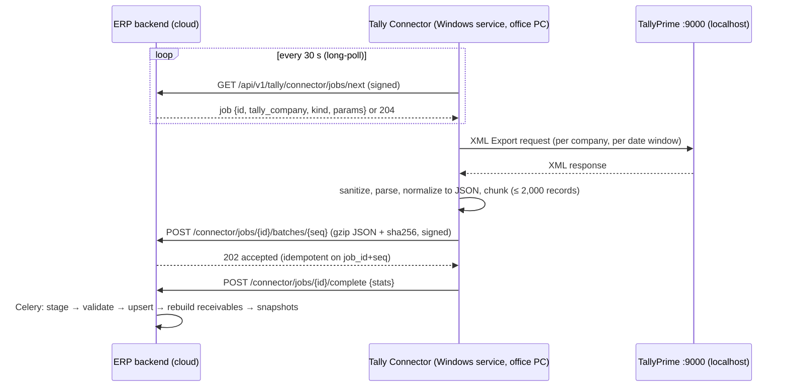

# G. TallyPrime Integration Architecture

> **Status of claims in this document:** this is a design. Field names and collection behaviour below follow TallyPrime's documented XML-over-HTTP interface, but **every request must be verified against the installed TallyPrime release and the actual company data** before the integration is called complete (quality rule 15). Step 6 begins with a discovery spike that records the real responses.

## 1. Topology



- **Outbound only.** The connector initiates every connection. No port is opened on the office network, Tally is bound to localhost / LAN only.
- **Authentication.** Each connector has an `api_key_id` and a secret (shown once at registration). Every request carries `X-Connector-Key`, `X-Timestamp`, `X-Signature = HMAC-SHA256(secret, method|path|timestamp|sha256(body))`. Backend rejects clock skew > 5 min and replays (nonce cache in Redis). TLS required. Keys can be rotated/revoked from *Integrations → Tally*.
- **Offline tolerance.** If Tally is closed or the internet is down, the connector keeps the job in its local SQLite queue and retries with exponential backoff (30 s → 15 min cap, jitter). Uploaded batches are kept locally for 7 days for re-send.

## 2. What is pulled

| Data | Source in Tally | Mode |
|------|-----------------|------|
| Companies | List of companies loaded | On connect |
| Ledgers under Sundry Debtors (and configured groups) — name, GUID, parent, opening balance, opening bill allocations, credit period, credit limit, GSTIN, AlterID | `Ledger` collection | Full nightly + incremental by `AlterID` |
| Vouchers: Sales, Receipt, Journal, Credit Note, Debit Note (and their user-defined child types) — GUID, MasterID, AlterID, type, number, date, party, amount, narration, cancelled/optional flags, ledger entries with **bill allocations** (bill name, bill type, amount, credit period) | `Voucher` collection filtered by type + date window | Full by month windows; incremental by `AlterID > last` |
| Bills outstanding per ledger (Tally's own pending figure) | Bills receivable / ledger outstanding report | Daily — used **only for reconciliation**, not as the primary source |
| Godowns, stock items (names only) | `Godown`, `StockItem` collections | On demand — for mapping, not stock |

Large exports are split into **monthly windows** so Tally does not hang on a full year; the connector also sets a per-request timeout and retries smaller windows on failure.

## 3. Sync modes

| Mode | When | How |
|------|------|-----|
| Initial full | First connection per company; on demand | Masters, then vouchers month by month from `books_from` |
| Incremental | Every 15 min in business hours (configurable) | Masters and vouchers with `AlterID > last_seen_alter_id`. Captures new and **altered** records. |
| Deletion sweep | Nightly | Tally's AlterID does not reveal deletions. For the current + previous month, the connector sends the full list of `(GUID, AlterID)`; backend marks vouchers missing from Tally as `is_deleted` (never hard-deletes) and flags the change. |
| Monthly reconcile | Weekly + on demand for any month | Re-pull a whole month and compare count/amount/hash per voucher type. Differences → `integration_sync_errors`. |
| Manual | "Sync now" button (Accounts Exec) | Creates a job the connector picks up within 30 s |

## 4. Backend import pipeline (idempotent)

1. **Stage** — each batch stored raw (S3, `raw_object_key`) and registered in `integration_sync_batches` (unique `job_id+batch_seq` → duplicate uploads ignored).
2. **Validate** — required fields, date parse, amount sign, party ledger exists, bill allocations sum to the party ledger amount. Bad records → `integration_sync_errors` with an excerpt; the rest of the batch continues.
3. **Upsert** — `tally_vouchers` keyed by `(tally_company_id, guid)`. If incoming `alter_id` ≤ stored, skip (duplicate). If higher, replace the voucher's bill references in one transaction. `raw_hash` detects no-op re-sends.
4. **Rebuild receivables** — for each affected ledger, recompute `receivable_invoices` and `receipt_allocations` from bill references (see §5). This is deterministic, so re-running it is safe.
5. **Snapshot** — write a new `outstanding_snapshots` row per affected dealer (`is_latest` swap), recompute aging buckets and priority scores, run promise matching.
6. **Reconcile** — compare computed `pending_amount` per bill with Tally's reported pending; mismatches set `receivable_invoices.mismatch` and appear on the *Reconciliation* screen.

Failed jobs retry automatically up to 5 times; individual failed records can be retried or marked ignored with a reason (audited).

## 5. Outstanding calculation (bill-wise, not "sales minus receipts")

For each receivable ledger:

- **Opening bills** from the ledger's opening bill allocations → `receivable_invoices(origin=OPENING)`.
- **New Ref** (sales, debit notes, debit journals) → creates a bill: `original_amount`, `bill_date` = voucher date, `due_date` = bill date + bill credit period (fallback: dealer `payment_terms_days`, then company default).
- **Agst Ref** (receipts, credit notes, credit journals) → `receipt_allocations` against that bill; reduces `pending_amount`. Part payments are just multiple allocations.
- **Advance** → unallocated credit with a reference (later adjusted by Agst Ref on a sale).
- **On Account** → unallocated credit without reference.
- Vouchers without bill allocations on a bill-wise ledger → treated as On Account and flagged for review.

Stored per dealer in the snapshot:

| Figure | Definition |
|--------|-----------|
| `ledger_balance` | Tally closing balance of the ledger (Dr positive) |
| `invoice_outstanding` | Σ pending of open bills |
| `unallocated_credit` | Advances + on-account + unallocated receipts |
| `net_exposure` | `invoice_outstanding − unallocated_credit` (≈ ledger balance; difference is shown as a reconciliation item) |
| `overdue_amount` / `current_amount` | Pending bills with due_date < today / ≥ today |
| Aging buckets | By due date (default) and by bill date (report option) |

The UI always labels **"Invoice-wise outstanding"** and **"Ledger balance"** separately.

## 6. Mapping

- **Customers are sourced from Tally (decision D5).** Each Sundry Debtors ledger in *Ishika Traders Daily* creates or updates a dealer (keyed by ledger GUID). A rename in Tally renames the dealer. A ledger deleted in Tally deactivates the dealer and never deletes it. Sales voucher inventory entries are also pulled (`tally_sale_lines`) to supply each customer's last-billed rate per item.
- **Dealer ↔ ledger:** one dealer may map to ledgers in several Tally companies (`tally_ledger_mappings.dealer_id`). Mapping UI with fuzzy-match suggestions; unmapped receivable ledgers are listed so nothing is silently dropped. His existing reality (sheet names ≠ ledger names, e.g. "RBM Builder (Sec-8)" = "RBM (Bagdola)") is handled by aliases on the dealer.
- **Company ↔ Tally company:** `tally_companies` row per Tally company file (e.g. A T Trading Co, Tayal Traders, and any non-GST books).
- **Credit limit:** ERP `dealers.credit_limit` is authoritative for order approval; Tally's credit limit is imported and shown, and a setting chooses which one wins.

## 7. Credit check freshness

`order_credit_checks.data_as_of` = time of the last successful voucher sync for that Tally company. If `now − data_as_of > tally.stale_threshold_minutes` (default 120), the check is marked **stale** and the configured policy applies: `HOLD` (default — order goes ON_HOLD for manager review), `WARN` (approve allowed with explicit acknowledgment) or `IGNORE_IF_WITHIN_LIMIT_BY_MARGIN` (allow if exposure < X % of limit).

## 8. Connector packaging

```
integrations/tally-connector/
  connector/  main.py (service loop), tally_client.py (XML requests/templates, sanitizer),
              parsers.py, queue.py (SQLite), uploader.py (signing, retries), config.py
  templates/  ledgers.xml, vouchers.xml, bills.xml, companies.xml   (TDL collection requests)
  tests/      recorded XML fixtures from the real Tally → parser tests
  installer/  PyInstaller spec, NSSM service install script, config.example.toml
```

Config: backend URL, connector key/secret (stored with Windows DPAPI), Tally URL (default `http://localhost:9000`), companies to sync, schedule, log retention. Logs to a rotating file + periodic heartbeat to the backend (`last_seen_at` shown on the Integrations page, alert if > 30 min silent in business hours).

Known Tally quirks handled: invalid XML control characters in names/narrations (stripped before parsing), `&` and Indian-locale amount formats, negative-sign conventions for Dr/Cr, optional and cancelled vouchers (excluded from outstanding but stored), company must be loaded in Tally for export (connector reports `COMPANY_NOT_LOADED`).

## 9. Out of scope in Phase 1 (designed for)

Writing vouchers into Tally (sales invoices from delivery orders, receipts from verified payments). The connector job model already supports a `WRITE_VOUCHERS` job kind and `tally_outbound_vouchers` is reserved; this can follow once the read side is trusted. See open question Q3.
