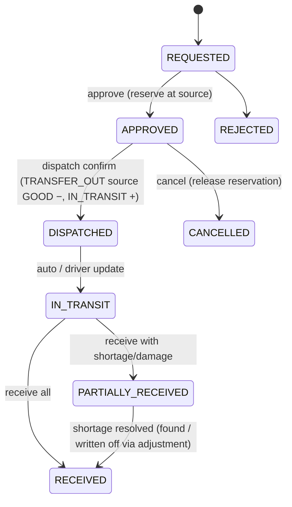
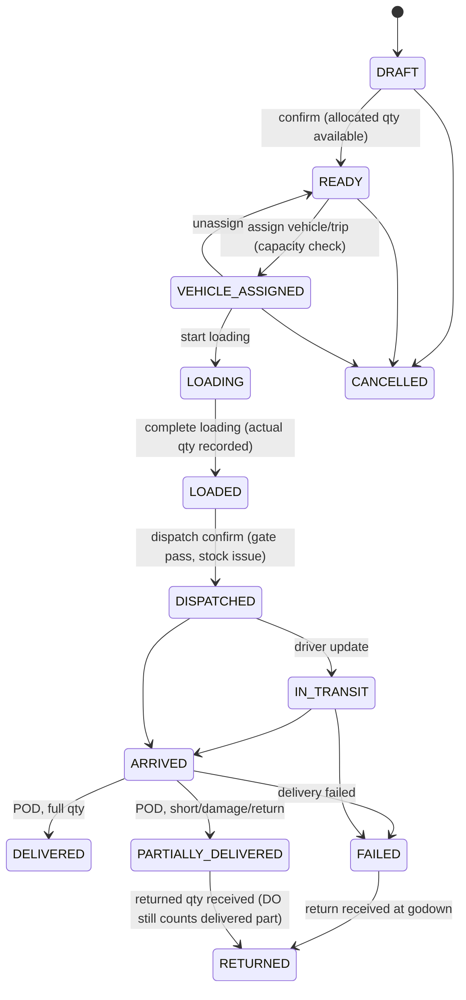
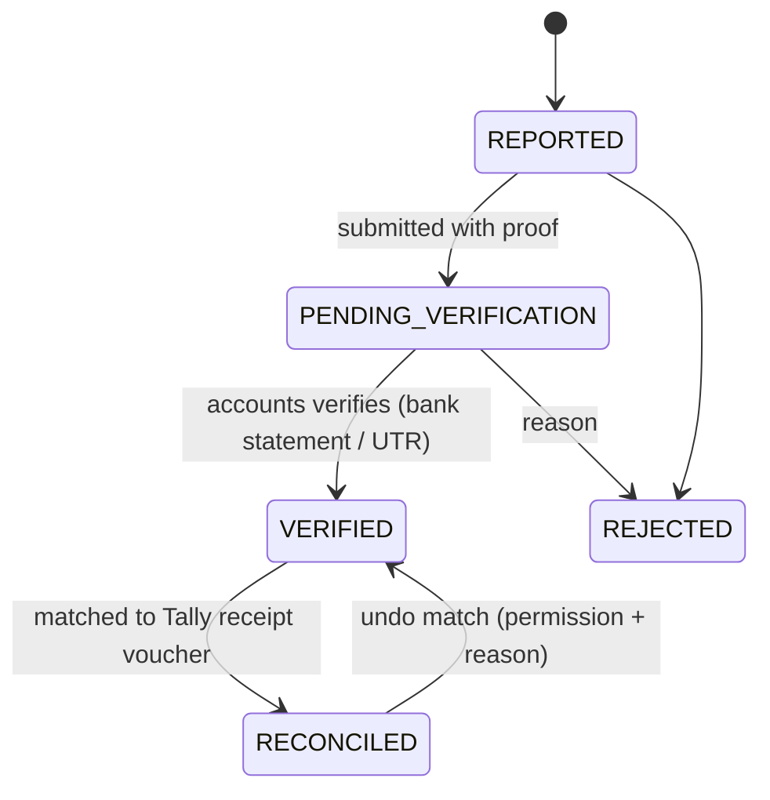

# H. Workflows & State Machines

All transitions are executed by backend commands. Each command: checks permission + data scope → loads the entity `FOR UPDATE` → checks the state machine → runs validations → writes changes, history, audit and outbox in **one transaction**. A transition not listed here returns `409 INVALID_TRANSITION`.

---

## 1. Sales order

```mermaid
stateDiagram-v2
  [*] --> DRAFT
  DRAFT --> SUBMITTED: submit
  DRAFT --> CANCELLED: discard
  SUBMITTED --> UNDER_REVIEW: auto (validation needs a human)
  SUBMITTED --> APPROVED: auto-approve (all checks pass & policy allows)
  UNDER_REVIEW --> APPROVED: approve
  UNDER_REVIEW --> REJECTED: reject
  UNDER_REVIEW --> ON_HOLD: hold (credit / stock / other)
  ON_HOLD --> UNDER_REVIEW: release
  ON_HOLD --> REJECTED: reject
  APPROVED --> ALLOCATED: derived (allocation recorded)
  ALLOCATED --> PARTIALLY_DISPATCHED: derived
  PARTIALLY_DISPATCHED --> DISPATCHED: derived
  ALLOCATED --> DISPATCHED: derived
  DISPATCHED --> PARTIALLY_DELIVERED: derived
  PARTIALLY_DISPATCHED --> PARTIALLY_DELIVERED: derived
  PARTIALLY_DELIVERED --> DELIVERED: derived
  DISPATCHED --> DELIVERED: derived
  DELIVERED --> CLOSED: close (manual or auto after N days)
  APPROVED --> ON_HOLD: hold
  ALLOCATED --> ON_HOLD: hold (releases nothing; blocks new DOs)
  SUBMITTED --> CANCELLED: cancel
  UNDER_REVIEW --> CANCELLED: cancel
  APPROVED --> CANCELLED: cancel (approval required)
  ALLOCATED --> CANCELLED: cancel (approval required, releases reservations)
  REJECTED --> DRAFT: reopen as new revision
```



**Two kinds of status.** *Decision states* (DRAFT, SUBMITTED, UNDER_REVIEW, APPROVED, ON_HOLD, REJECTED, CANCELLED, CLOSED) change only via commands. *Fulfilment states* (ALLOCATED → DELIVERED) are **derived** by `orders.service.recompute_status()` from line quantities whenever allocation/dispatch/delivery events change them:

| Derived status | Rule (over open, non-cancelled lines) |
|----------------|---------------------------------------|
| ALLOCATED | approved and Σ allocated > 0, nothing dispatched |
| PARTIALLY_DISPATCHED | 0 < Σ dispatched < Σ ordered−cancelled |
| DISPATCHED | Σ dispatched = Σ ordered−cancelled, nothing delivered |
| PARTIALLY_DELIVERED | 0 < Σ delivered(+short/returned resolved) < Σ dispatched or < ordered |
| DELIVERED | every open line fully delivered or its remainder cancelled/resolved |

`allocation_status` (NONE/PARTIAL/FULL) is shown separately so "approved but only 60 % allocated" is visible without new states.

**Permissions per command**

| Command | Permission | Extra rule |
|---------|-----------|-----------|
| create / edit draft | `orders.create` | sales exec only for assigned dealers |
| submit | `orders.create` | runs validation |
| approve | `orders.approve` | cannot approve own order if `orders.self_approval` disabled |
| hold / release | `orders.hold` | reason required |
| reject | `orders.approve` | reason required |
| cancel before approval | `orders.cancel` | reason |
| cancel after approval / partial cancel | `orders.cancel_approved` → approval request | releases reservations |
| material revision after approval | `orders.revise` → approval request | see §1.3 |
| credit override / release CREDIT hold | `credit.override` | **admin only** (Super Admin, Business Owner), reason required |
| rate below the dealer's authorised rate − tolerance | `orders.rate_override` | approval request |
| close | `orders.close` | only DELIVERED or all remaining cancelled |

### 1.1 Submit-time validation

| Check | Failure → |
|-------|----------|
| Dealer ACTIVE, not BLOCKED | error (cannot submit) |
| Products active and sellable in company; UoM allowed | error |
| Quantity > 0, conversions resolvable | error |
| Rate ≥ resolved `min_rate` | UNDER_REVIEW with `RATE_APPROVAL` reason |
| Stock: available (GOOD, permitted owners) ≥ required, else `backorder_allowed` | UNDER_REVIEW with `STOCK_SHORTAGE` + godown suggestions |
| Credit (policy STRICT/WARN): exposure = net outstanding + open approved-not-invoiced orders + this order vs limit; overdue days vs allowed | STRICT → ON_HOLD `CREDIT`; WARN → UNDER_REVIEW flag |
| Tally data stale | apply stale policy (default ON_HOLD) |
| Duplicate (same `dedupe_hash` within window) | requires `confirm_duplicate=true` |

Auto-approval to APPROVED happens only if every check passes **and** the setting `orders.auto_approve` is on for that company/source; otherwise UNDER_REVIEW.

### 1.2 Approval = reservation (atomic)

`approve()` in one transaction: re-runs credit and rate checks (state may have changed), locks `inventory_balances` for candidate buckets, creates `inventory_reservations` + `order_allocations` according to the chosen allocation plan (from suggestion or user edits), writes `order_approvals`, status APPROVED → derived ALLOCATED if anything was reserved. If stock vanished between suggestion and approval, the command fails with `STOCK_CHANGED` and fresh suggestions — never silently reserves less.

**Godown suggestion** ranking: (1) dealer's preferred / order line's preferred godown, (2) godowns that can fill the full line alone, (3) nearest to delivery address (distance table), (4) oldest batch first for cement (FIFO), (5) fewest godowns. Only owners permitted for the selling company (`owner_sale_rules`).

### 1.3 Revisions

- DRAFT edits overwrite the draft (still versioned by `version`).
- After SUBMITTED, every edit creates `order_revisions` row with a full snapshot. Approved values live in revision `approved_revision` and are never modified.
- **Material change** (qty up, rate down, product/godown/dealer/delivery address change, tax treatment) after approval → approval request; until approved the order continues on the approved revision.
- Qty decrease = partial cancellation → releases the excess reservation (cannot go below dispatched qty).

---

## 2. Inventory

### 2.1 Stock receipt
```
DRAFT → PENDING_GRN → RECEIVED        (CANCELLED from DRAFT/PENDING_GRN)
```
- Excel import creates receipts in **PENDING_GRN**; no stock is posted until the godown supervisor confirms received good/damaged/short quantities (setting `inventory.require_grn_confirmation`, default on).
- On RECEIVED: post `RECEIPT` movements (GOOD), `STATUS_CHANGE` to DAMAGED for damaged bags, record shortage on the receipt (no stock movement for qty never received). Creates `stock_batches` (receipt date = batch for cement age).

### 2.2 Excel import flow
`upload → map columns (saved templates per supplier) → preview (first 50 rows + all errors) → validate (products resolvable, godown resolvable, duplicate invoice in DB or file, qty>0) → post (one transaction per job, all-or-nothing) → import history`.

### 2.3 Reservation lifecycle
`ACTIVE → PARTIALLY_CONSUMED → CONSUMED`; `ACTIVE/PARTIALLY_CONSUMED → RELEASED` (order cancel, qty decrease, reallocation). Consumption happens only at dispatch confirmation.

### 2.4 Godown transfer

In-transit quantity sits in a virtual location — **not available at source or destination**. Damage on receipt posts to destination DAMAGED; shortage stays in-transit until resolved by an approved adjustment.

### 2.5 Adjustment
`DRAFT → PENDING_APPROVAL → APPROVED → POSTED` (or REJECTED). Approval policy by type and value (e.g. damage ≤ 10 bags auto-approved for supervisor; anything else Ops Manager). Reason code mandatory; attachment mandatory for DAMAGE and SHORTAGE. Posting creates paired or single movements.

### 2.6 Cement & TMT specifics
- Cement: batch = receipt; *stock age* = today − receipt date; dashboard flags > configurable days (default 45 for PPC, 60 for OPC — configurable per product). Damage reasons: `MOISTURE, HARDENED, TORN_BAG, HANDLING`. FIFO suggestion ranks oldest GOOD batch first but never forces it.
- TMT: stock in KG with pieces/bundles carried on movements; heat number on batch; loading records actual weighbridge weight → **variance report** (nominal vs actual, per DO, product, godown, transporter).

---

## 3. Dispatch

### 3.1 Delivery order

"Exception" on the planning board is a **flag** (`has_open_exception`), not a state — a DO can be IN_TRANSIT *and* have an open breakdown exception.

### 3.1a Direct dispatch (decision D6)
A vehicle loaded at the factory/railhead for a customer is allocated to the **Direct** godown (kind `DIRECT`). One command, `POST /dispatch/direct`, takes `{order, vehicle, supplier/SAP dispatch ref, qty}` and in one transaction:
1. receives the quantity into Direct (`RECEIPT`);
2. reserves it for that order;
3. creates the DO and trip and confirms the dispatch (`DISPATCH_ISSUE`).

The Direct godown's balance returns to zero, and the stock is never available to other orders. Delivery, POD and exceptions then follow the normal flow.

### 3.2 Stock posting rules
| Event | Stock effect |
|-------|-------------|
| DO created / READY | none (uses existing order reservation) |
| Loading complete | none; records actual loaded qty. If loaded < planned, remainder stays reserved for the order. Damaged-at-loading → STATUS_CHANGE GOOD→DAMAGED |
| **Dispatch confirm** | `DISPATCH_ISSUE` −loaded qty from GOOD bucket; reservation consumed by same qty; order line `qty_dispatched` += |
| POD delivered | order line `qty_delivered` +=; no stock movement (already issued) |
| POD short (lost in transit) | creates SHORTAGE exception + resolution task; no stock re-entry |
| Return to godown | `DELIVERY_RETURN` + into QUARANTINE (inspector moves to GOOD/DAMAGED) |
| Failed delivery | exception; when vehicle returns → `DELIVERY_RETURN` |

### 3.3 Vehicle capacity
Planned load (Σ base qty × product weight) ≤ vehicle `capacity_kg` (+ configurable tolerance %). Over capacity → blocked unless `dispatch.capacity_override` with reason.

### 3.4 POD
Recipient name + phone, signature (canvas → PNG), ≥ 1 photo (configurable), delivered/short/damaged per line, optional OTP sent to dealer contact (hash stored, 10-min expiry, 5 attempts). Captured offline allowed — stored with `device_captured_at` and `client_uuid`; server validates delivered ≤ dispatched on sync.

### 3.5 Freight
Estimate at trip planning from the most specific matching rate card (transporter+dealer > transporter > dealer > godown+vehicle type > default). Agreed freight set by Ops. Additional charges (detention, unloading, toll) require approval above a threshold. Variance = actual − agreed shown on dashboard.

### 3.6 Exceptions
`OPEN → IN_PROGRESS → RESOLVED → CLOSED`; every change appends `exception_events`. Owner required. Auto-created for shortage/damage at POD, failed delivery, and DOs not delivered by expected date + N hours (beat job).

---

## 4. Collections

### 4.1 Payment report

Only **RECONCILED** (i.e. present in Tally) changes authoritative outstanding — because outstanding is computed from Tally. VERIFIED-not-yet-in-Tally amounts are shown separately as "verified, awaiting Tally entry". Duplicate UTR within company is rejected.

**Matching rule (auto-suggest, human confirms by default):** same dealer, amount equal (± ₹1), Tally date within −2/+7 days of payment date, reference/UTR found in narration scores higher. Setting `payments.auto_reconcile_exact` allows auto-match when UTR matches exactly.

### 4.2 Promise to pay
```
OPEN → PARTIALLY_FULFILLED → FULFILLED
OPEN/PARTIALLY_FULFILLED → BROKEN   (beat job: promise_date + grace_days passed, received < promised × threshold)
OPEN → SUPERSEDED (new promise replaces) | CANCELLED
```
Receipts counted toward a promise: Tally receipt vouchers for the dealer dated between promise creation and `promise_date + grace_days`, not already matched to another promise, optionally restricted to the promise's invoices. Fulfilled when Σ ≥ promised × `fulfil_threshold` (default 100 %). Broken promises increment the dealer's broken-promise count and create an escalation follow-up.

### 4.3 Follow-up generation (beat, daily 07:00 IST, idempotent via `generated_key = dealer:date`)
For each dealer with overdue > threshold and no planned follow-up in the next N days → create PLANNED follow-up for the assigned collection executive; promises due today → follow-up "check promise"; broken yesterday → escalation to manager.

### 4.4 Priority score (rules-based, transparent)
`score = Σ wᵢ · normᵢ` with factors: overdue amount (log-scaled vs company max), max overdue days, broken promises (last 90 days), payment trend (last 60 days receipts vs prior 60), credit exposure (outstanding / limit). Weights in settings; `factors` JSON and `rule_version` stored with each score; manager override with reason (audited). Labelled in UI as **"Rule-based priority"**.

---

## 5. End-to-end scenarios (these become the E2E test suite)

| ID | Flow | Key assertions |
|----|------|----------------|
| **A — Normal order** | create → submit → auto/approve (reserve Nasirpur 400 bags) → DO → assign vehicle → load 400 → dispatch → POD 400 | balance on_hand −400, reserved back to 0; order DELIVERED; movements sum = balance |
| **B — Insufficient stock** | order 600 bags; Nasirpur has 400, Uttam Nagar 100 → suggestion split → approve partial (500) → dispatch 500 → 100 remain pending | allocation_status PARTIAL; order PARTIALLY_DISPATCHED; no negative stock; later receipt allows allocating remaining 100 |
| **C — Credit hold** | dealer over limit → submit → ON_HOLD (CREDIT) with credit check record; manager override with reason → APPROVED; second case: Tally data 5 h old → stale flag → HOLD policy applied | override audited; stale shown explicitly; rejection path cancels |
| **D — Payment follow-up** | Tally sync shows overdue bill → follow-up generated → exec logs call, promise ₹2 L for Friday → payment reported with UTR → accounts verifies → Tally receipt imported → reconciled → promise FULFILLED; variant: no receipt → BROKEN + escalation | promise not fulfilled by report alone; no duplicate reminder on task retry |
| **E — Godown transfer** | request 200 bags Nasirpur→Uttam Nagar → approve (reserved) → dispatch (in-transit 200, not available at either) → receive 195 good + 3 damaged + 2 short → shortage adjustment approved | in-transit counted once; totals reconcile |
| **F — Partial delivery** | DO 300 dispatched → POD 290 delivered, 10 damaged returned → return to QUARANTINE → resolution task | order line delivered 290; returned 10 visible; exception closed with resolution |
