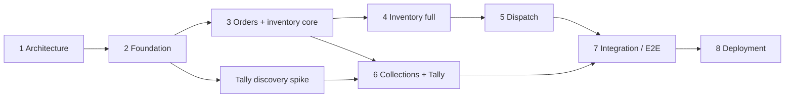

# J. Development Plan, Dependencies & Acceptance Criteria

Order follows the brief (Orders → Inventory → Dispatch → Collections) with one adjustment: a **minimal inventory core** (balances, movements, reservations) is built inside Step 3 so that order approval really reserves stock from day one instead of being stubbed. Collections' Tally **discovery spike** starts in parallel as early as Step 2, because it depends on access to the real Tally machine and is the biggest unknown.

Each step ends with: tests green in CI, migrations applied from scratch and upgraded from the previous step, a short demo script on seed data, and a written report of test results and known limitations.

---

## Step 2 — Project foundation

**Backlog**
1. Monorepo skeleton (`backend/ web/ mobile/ integrations/tally-connector/ infrastructure/ docs/`), root README, Makefile, pre-commit (ruff, mypy, eslint, prettier, dart format).
2. `docker-compose.yml`: postgres, redis, minio, api, worker, beat, web, caddy, mailpit; healthchecks.
3. FastAPI core: settings, DB session, error handler (problem+json), request id, structlog, pagination, Decimal JSON, idempotency middleware, audit service, outbox + publisher task, document sequences, scoped query helper.
4. Identity: users, roles, permissions, per-company roles, godown scopes, login/refresh/logout with rotation, `/auth/me`, rate limits.
5. Masters: companies, employees, dealers (+contacts, addresses, assignments), brands, products, UoMs, conversions (+convert endpoint), godowns, owners & sale rules, transporters, vehicles, drivers, price lists, settings.
6. Attachments (presigned upload/download), notifications (in-app + FCM stub), approvals engine (generic request/decide with policy lookup).
7. Alembic baseline migration; seed command: `seed --demo` creates **"DEMO Trading Co"** only (never touches real companies); `seed --base` loads roles/permissions/UoMs.
8. Next.js shell: auth, company switcher, sidebar from permissions, design system (table, filters, form, dialog, toast, empty/error states), masters CRUD pages, generated API client.
9. Flutter shell: login, secure token storage + refresh interceptor, company/role navigation, encrypted local DB, sync-queue framework, push registration.
10. CI (GitHub Actions): lint, type-check, pytest with Postgres service, web tests, flutter test, OpenAPI client generation check.

**Acceptance criteria**
- `docker compose up` brings everything up; `/health/ready` green; web login works with seeded admin; Android emulator logs in against local API.
- Token refresh rotates; reusing an old refresh token revokes the family (test).
- A user with a role only in Company A gets 403/404 on every Company B resource (isolation test suite skeleton runs over all routers).
- Conversion API: `25 MT` Shree PPC → `500 BAG`; JSW 20 kg pack `1 MT → 50 BAG`; Kamdhenu 12 mm `10 PC → 106.56 KG` (from seeded chart) — exact Decimal results.
- Audit row written for every master create/update.

---

## Step 3 — Order management (+ inventory core)

> **Status (9 Nov 2026):** built and tested — booking, pricing from dealer rates, credit check, approvals/holds, drafts, duplicate guard, web booking (Android booking screens written; verify on the Mac build). Stock reservation moves to Step 4 (decision D15).

**Backlog**
1. Inventory core: owners, balances, movements service (`post_movements`), reservations service with row locking, opening-balance posting, availability query.
2. Orders: models, numbering, create/edit draft, submit validation (dealer, product, qty, rate resolution, stock, credit — credit uses manual/opening outstanding until Step 6), dedupe, state machine, approve-with-allocation, suggestions, hold/release/reject, revisions with snapshots, material-change approval, cancel/partial cancel with reservation release, status history, derived fulfilment status.
3. Order dashboard & list queries, Excel export.
4. Web: orders dashboard, list, new/edit form (unit-aware lines, dealer side panel), detail, review & approve (allocation editor), revisions diff.
5. Android: sales exec home, order list/detail, new order with offline draft, approvals for managers.

**Acceptance criteria**
- Every transition not in the state machine returns 409; status cannot be set via PATCH.
- **Concurrency test:** 20 parallel approvals competing for 1,000 bags at one godown never reserve more than 1,000; `available` never negative; balances = Σ movements.
- Approve with a split across two godowns creates two reservations; cancel releases both; partial cancel releases only the excess.
- Post-approval qty increase creates a pending revision; the approved revision is unchanged until approval.
- Duplicate submission within window requires confirmation; idempotent retry of submit returns the same response.
- C&F-owned stock is never suggested for an own-trading order unless an `owner_sale_rules` row allows it.

---

## Step 4 — Inventory management (full)

**Backlog**: stock receipts (manual, PENDING_GRN confirmation), batches, Excel import wizard with mapping templates (Shree, Ambuja exports), duplicate invoice detection, transfers with virtual in-transit, adjustments with approvals and attachments, stock counts, cement aging, TMT weight fields & variance, inventory dashboard, stock position grid, stock ledger, nightly ledger-vs-balance check job; Android: supervisor home, GRN confirm, transfers dispatch/receive, damage raise, stock lookup.

**Acceptance criteria**
- Import of a sample Shree/Ambuja Excel: preview shows mapped rows and errors; same invoice imported twice is blocked; posting creates PENDING_GRN receipts and **no** stock until GRN confirmation.
- Transfer of 200: after dispatch, source available −200, destination unchanged, in-transit 200; after receiving 195+3 damaged+2 short: destination GOOD +195, DAMAGED +3, shortage awaiting adjustment; company-wide total physical changes only by the approved shortage.
- No API path changes a balance without a movement (test enumerates movement-creating services; DB grants deny UPDATE on movements).
- Nightly reconciliation job flags a deliberately corrupted balance in test.

---

## Step 5 — Dispatch & logistics

> **Status (9 Nov 2026):** core built and tested on the web — delivery orders per truck, capacity check, loading, gate-out, delivery with short/damaged, printable gate pass, Direct godown reference. Still to do: driver app trips, POD photos/OTP, freight, exceptions.

**Backlog**: DOs from orders (split), trips, vehicle assignment with capacity check, planning board (backend board query + web kanban with command-backed drag), loading entry, loading slip & gate pass PDFs, dispatch confirm (stock issue + reservation consume), driver app (trips, status events, POD with signature/photos/OTP, offline queue), returns into quarantine, exceptions with history and auto-creation, freight rate cards/estimates/approval, dispatch dashboard.

**Acceptance criteria**
- Loaded 380 of planned 400 → dispatch issues 380; the 20 stays reserved for the order; order PARTIALLY_DISPATCHED.
- One trip with 3 DOs from 2 orders dispatches atomically (all or nothing) and produces one gate pass.
- Over-capacity trip blocked without override permission.
- POD 290 of 300 with 10 returned → order line delivered 290, exception auto-created, return posted to QUARANTINE after receipt.
- POD submitted twice (offline retry) creates one POD.
- Drag on the board to an invalid column is rejected by the API and the card snaps back.

---

## Step 6 — Payment collection & Tally

**Backlog**
0. *(starts during Step 2)* **Discovery spike** on the real Tally machine: TallyPrime release, company list, sample XML for ledgers, vouchers with bill allocations, bills outstanding; store anonymised fixtures in `integrations/tally-connector/tests/fixtures`.
1. Connector service (queue, signing, retries/backoff, heartbeat, installer).
2. Backend connector API, staging, validation, idempotent upsert, deletion sweep, errors UI.
3. Receivable rebuild (bill-wise), outstanding snapshots, aging (due/bill date), reconciliation with Tally's pending figures.
4. Dealer↔ledger mapping UI with suggestions.
5. Assignments, follow-ups, generation job, promises + matching + broken detection, payment reports + verification + reconciliation, targets, priority score, collection dashboard, dealer statement.
6. Plug real outstanding into order credit check incl. staleness policy.
7. Android: collection exec home, follow-up logging, promise, record payment with proof.

**Acceptance criteria**
- Re-uploading the same batch or job produces zero changes; an altered voucher (higher AlterID) replaces its bill allocations; a voucher deleted in Tally is marked deleted by the sweep.
- For a test ledger with opening bills, part payments, advance, on-account receipt, credit note and journal: computed bill-wise pending matches Tally's bills-outstanding report exactly; ledger balance vs invoice-wise difference equals unallocated credit.
- Aging buckets computed from due date; "not yet due" separate.
- A promise is not fulfilled by a payment report alone; it becomes FULFILLED only after a matched Tally receipt; a broken promise generates exactly one escalation even if the job runs twice.
- Credit check with Tally data older than the threshold shows "stale" and applies the configured policy.
- **Integration is declared complete only after a successful run against the actual Tally company data** (not fixtures alone).

---

## Step 7 — Integration testing

- Playwright E2E for Workflows A–F on web against docker-compose with seed data; Flutter integration tests for sales order, follow-up/payment, loading, POD flows against the same stack.
- Isolation suite across all endpoints; permission matrix test generated from the seeded role matrix.
- Load sanity: 50 concurrent users, dashboards < 1 s p95 on seed volume ×10.
- Pilot checklist with real masters (dealers, products, godowns, opening stock) in a staging copy.

**Acceptance**: all six scenarios pass end-to-end; no ledger/balance discrepancies after the run; zero unhandled errors in logs.

---

## Step 8 — Deployment preparation

Local setup guide, `.env.example`, migration commands (`alembic upgrade head`), seed commands, test commands; production Docker images (multi-stage, non-root); backup scripts + restore drill; AWS plan: ECS Fargate, RDS PostgreSQL Multi-AZ + PITR, ElastiCache, S3 (versioned), Secrets Manager, ALB + ACM, CloudWatch alarms, ap-south-1; Tally connector installation guide; go-live runbook (opening stock count, dealer mapping, first full Tally sync, parallel run with existing process for 2 weeks).

---

## Testing pyramid (all steps)

| Layer | Tooling | Focus |
|---|---|---|
| Unit | pytest | conversions, state machines, aging, priority score, matching rules, bill-wise rebuild |
| Service/DB | pytest + real Postgres (testcontainers / compose service), transactions rolled back per test | reservations, movements, concurrency (threads), idempotency, isolation |
| API | pytest + httpx | permissions, validation, error codes |
| Web | Vitest + Testing Library, MSW only for component tests; Playwright for E2E against real API | forms, tables, board |
| Mobile | flutter_test (unit/widget), integration_test | sync queue, offline drafts, role navigation |
| Connector | pytest with recorded Tally XML fixtures | parsing, sanitising, retries |
